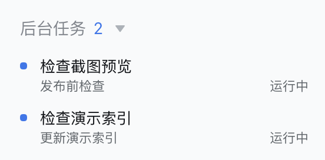
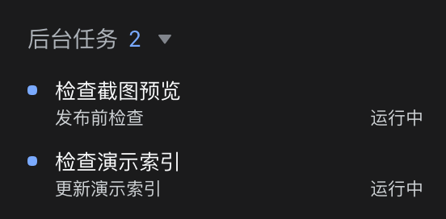
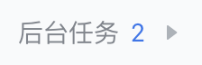
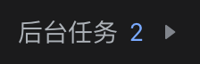

# Background jobs sidebar

[简体中文](README.zh.md)

The expanded left sidebar lists live jobs directly above the account control.
It shows the jobs and their owners across sessions, including shared jobs.
Select a row with a known session to open its conversation.
The list updates as jobs start, begin stopping, and settle.

In DeepSeek Harness `0.2.2-rc.5`, open **Plugins → Add plugin** and enter `@miorin/dsh-background-jobs-sidebar`
for a standalone installation.
You can also enable it in the locally installed **List Modular Improvement Plan**.
Both bundles use the same plugin row, so enable one at a time.

The list follows the same DSH job registry as the session header.
It also shows foreground commands while DSH tracks them as jobs.
[Development and verification](docs/README.md)

## Screenshots

Expand **Background jobs** to see live jobs and the sessions they belong to.
The screenshots show the Chinese interface.

| | Light | Dark |
| --- | --- | --- |
| Expanded job list |  |  |
| Collapsed job list |  |  |
