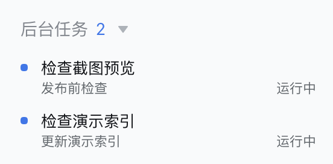
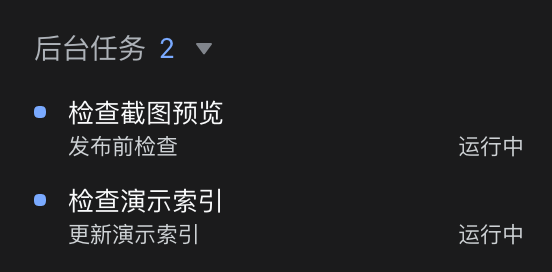
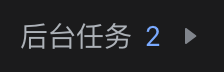

# 后台任务侧栏

[English](README.md)

展开左侧边栏，在底部账号控件上方查看后台任务。
列表汇总各会话及共享任务，随任务开始、停止和结束自动更新。
点击已知会话的任务可打开对应对话。

在 DeepSeek Harness `0.2.2-rc.5` 的「插件 → 添加插件」输入 `@miorin/dsh-background-jobs-sidebar` 即可独立安装。
也可以在本地安装的「列表模块化改良计划」中启用。
两种安装方式共用同一个插件行，同一时间启用其中一种。

列表和会话标题栏使用同一个 DSH 任务注册表。DSH 登记的前台命令也会在执行期间出现。
[开发与验证](docs/README.md)

## 界面截图

展开侧栏底部的「后台任务」，即可看到正在运行的任务及其所属会话。

| | 浅色 | 深色 |
| --- | --- | --- |
| 展开任务列表 |  |  |
| 收起任务列表 |  |  |
